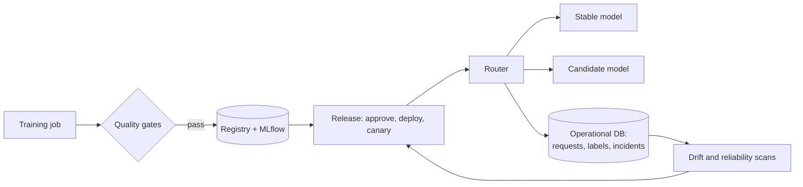

# KubeML

A local first model operations platform for ML engineers who want to see the whole release loop in one place: train a small credit risk model, record the run, gate the artifact, serve it, and move canary traffic or roll back with evidence.

## What it does

- Trains a deterministic credit risk classifier on startup if there is no champion model yet.
- Logs each run to MLflow and to its own registry, with dataset fingerprint, artifact SHA256 and git commit.
- Blocks promotion until quality gates pass. A successful training run is not enough on its own.
- Serves predictions from a pinned JSON artifact, either in process or through a separate serving service.
- Routes canary traffic with a deterministic weight counter, and only raises the weight once there is enough evidence on errors, latency and validity.
- Opens a drift investigation when features drift. Drift cannot be configured as an automatic rollback trigger.
- Retrains on drift or a performance drop and registers the result as a `candidate` version for review ([details](#drift-triggered-retraining)).
- Rolls back idempotently to the stable model and smoke tests it.
- Ships a React control room (mission, registry, releases, drift, reliability, cluster, policy, timeline), Compose files for PostgreSQL, MinIO, MLflow, Prometheus, Alertmanager and Grafana, a Helm chart, a kind script and an optional Terraform EKS path.

## The model

There was no existing model to wrap, so the platform ships its own small fallback model:

| | |
| --- | --- |
| Task | Binary classification of **synthetic** loan default |
| Estimator | L2 logistic regression on CPU, coefficients stored as JSON |
| Inputs | 8 numeric features plus `housing` and `loan_purpose` (`credit-risk.features.v1`) |
| Output | `default` or `no_default`, with a probability between 0 and 1 |
| Data | Deterministic synthetic book written to `data/datasets/credit_risk_v1.csv` (4000 rows, seed 7) |
| Split | 70% train, 15% validation, 15% fixed test. The scaler is fit on train only |
| Gate | Validation ROC AUC must be at least 0.70 |

Serving loads that JSON file. It never unpickles an artifact, and a running process does not follow an MLflow alias change.

## How it works



The platform API (FastAPI, `kubeml-platform`) owns training jobs, the registry, releases, routing, incidents and drift. By default it uses SQLite under `data/` and an MLflow file store, and routes traffic in process. With Compose it uses PostgreSQL and MinIO instead. The cluster page calls `kubectl` and says plainly when there is no cluster.

## Quick start (no Docker)

Checked on Linux with Python 3.12 and Node 20 on 1 November 2026.

```bash
python -m venv .venv
.venv/bin/pip install -e ".[dev]"
.venv/bin/pytest
.venv/bin/kubeml-platform           # API on port 8080, trains the first model
```

In a second terminal:

```bash
cd frontend
npm ci
npm run dev                         # UI on port 5173
```

On Windows use `.venv\Scripts\...` instead of `.venv/bin/...`.

Local demo accounts (seeded into the local database only):

| Username | Role | Password |
| --- | --- | --- |
| admin | Platform administrator | `kubeml-local` |
| engineer | ML engineer | `kubeml-local` |
| approver | Release approver | `kubeml-local` |
| observer | Read only observer | `kubeml-local` |

Optional separate serving process, after the platform has written an artifact:

```bash
KUBEML_MODEL_PATH=$(ls data/artifacts/*.json | head -1) .venv/bin/kubeml-serving
```

## Real output

From a fresh clone on 1 November 2026. On first start the platform trained and registered version 1:

```
Successfully registered model 'credit-risk'.
Created version '1' of model 'credit-risk'.
INFO:     Uvicorn running on http://0.0.0.0:8080 (Press CTRL+C to quit)
```

Metrics stored with that version (`GET /api/v1/models`, rounded). These come from the synthetic data, so they say nothing about real lending:

| Split | Samples | Accuracy | Precision | Recall | F1 | ROC AUC | Brier |
| --- | --- | --- | --- | --- | --- | --- | --- |
| Validation | 600 | 0.867 | 0.819 | 0.511 | 0.630 | 0.891 | 0.098 |
| Test | 600 | 0.872 | 0.769 | 0.602 | 0.675 | 0.910 | 0.090 |

A prediction through the gateway:

```bash
curl -X POST localhost:8080/api/v1/gateway/predict \
  -H "Authorization: Bearer $TOKEN" -H 'content-type: application/json' \
  -d '{"features":{"age":35,"annual_income":42000,"debt_ratio":0.45,"credit_history_years":6,"open_accounts":4,"delinquencies_2y":1,"employment_years":3,"loan_amount":12000,"housing":"rent","loan_purpose":"auto"}}'
```

```json
{"slot":"stable","prediction_id":"prd_f212f35aba0744a8","label":"default","score":0.5061015113156471,"model_version_id":"mdl_cc9aabbf541f"}
```

Get `$TOKEN` from `POST /api/v1/auth/login` with `{"username":"engineer","password":"kubeml-local"}` (the response field is `token`). A feature value outside the contract, such as an unknown `loan_purpose`, returns `{"error":"Inference failed: error."}` with status 422. The allowed values are listed at `GET /api/v1/contract`.

## Drift-triggered retraining

`kubeml-retrain` (`src/kubeml/retrain.py`) closes the loop between drift monitoring and the registry:

1. Rebuilds the champion from the fixed reference split and registers it once in MLflow with the `champion` alias.
2. Takes a new labelled batch, uses the first half as the monitoring window and keeps the second half as a holdout neither model trains on.
3. Runs PSI, KS and JS drift checks against the champion's training data and scores the champion on the window.
4. Retrains only if at least 2 features drift or the champion's ROC AUC drops by more than 0.03 against its validation score.
5. Retrains on the reference training rows plus the window, runs the same five release gates, logs the run to the `kubeml-retraining` MLflow experiment and registers a new model version with the `candidate` alias. Promotion to champion still goes through the release flow. Nothing is promoted automatically.

The job is one command with a JSON report, so it can run from cron or a scheduled CI job. The retraining tests in `tests/test_retrain.py` run in the existing CI workflow.

Local runs on 24 November 2026 (CPU, 2,000 row batches, batch seed 101, fresh data directory, run in this order). Reports are in [docs/evidence/retraining](docs/evidence/retraining):

| Batch | Drifted features (PSI) | Champion AUC drop on window | Decision | Holdout ROC AUC, champion vs candidate | Registry |
| --- | --- | --- | --- | --- | --- |
| `reference` | none (all PSI under 0.03) | 0.017 | No retrain | 0.901, no candidate | v1 `champion` |
| `shift_purpose` | `loan_purpose` (1.58) | -0.013 | No retrain: 1 feature is under the 2 feature rule | 0.895, no candidate | unchanged |
| `drifted` | `debt_ratio` (14.35), `annual_income` (0.87), `delinquencies_2y` (0.74), `housing` (0.64) | -0.0001 | Retrain, all 5 gates passed | 0.8723 vs 0.8734 | v2 `candidate` |

What this shows honestly: the synthetic drift moves the inputs but not the rule that turns inputs into defaults, so the champion barely loses ranking quality and retraining only adds about 0.001 ROC AUC on the holdout. The trigger, gating and versioning work. The size of the gain would depend on real concept drift, which this data does not contain.

Reproduce:

```bash
for s in reference shift_purpose drifted; do
  KUBEML_DATA_DIR=/tmp/kdata .venv/bin/kubeml-retrain --scenario $s --rows 2000 --batch-seed 101 \
    --report docs/evidence/retraining/retrain_$s.json
done
```

## Checks

| Check | Result on 1 November 2026 |
| --- | --- |
| `ruff check src tests` and `ruff format --check` | Clean |
| `pytest` | 13 passed (19 deprecation warnings from MLflow). 18 passed on 24 November 2026 after adding the retraining tests |
| `frontend`: `npm run typecheck`, `npm test`, `npm run build` | Pass, 5 Vitest tests |
| Platform start, login, models, contract, predict | Worked as shown above |
| Compose stack, kind cluster, Helm, Terraform, Playwright | Not run in this check |

GitHub Actions (`.github/workflows/ci.yml`) runs the Python and frontend checks, builds both images, lints and templates the Helm chart, validates Terraform and installs the chart on a kind cluster with a smoke job. The latest run on `main` passed.

## Run with Docker Compose

```bash
docker compose up --build
```

Compose adds PostgreSQL, MinIO, MLflow, Prometheus, Alertmanager and Grafana. The platform API is published on port 8096, Grafana on 3000 (`admin` / `kubeml-local`), Prometheus on 9090, MLflow on 5000 and Alertmanager on 9093. After the serving image builds, `python scripts/record_image.py` records its local image id when the baked artifact matches a registered model.

## Kubernetes

`bash scripts/kind/up.sh` creates a kind cluster, installs metrics-server, builds the images and installs the Helm chart. `scripts/kind/down.sh` deletes it. The production values file requires image digests, and staging deploy is refused without a reachable cluster and a digest. Cloud notes are in [docs/CLOUD.md](docs/CLOUD.md).

## Project structure

```
src/kubeml/
  platform/app.py   FastAPI control plane (auth, runs, registry, releases, drift, incidents)
  serving/app.py    Standalone inference service
  training.py       Training job and artifact writer
  retrain.py        Drift check, retraining trigger and candidate registration
  dataset.py        Synthetic credit risk data
  gates.py          Promotion gates
  releases.py       Canary and rollback logic
  drift.py          Feature drift analysis
  ops.py            Platform orchestration and the in process router
  cluster.py        kubectl wrapper
frontend/           React + Vite control room, Vitest and Playwright tests
deploy/docker/      Dockerfiles and nginx config
deploy/helm/kubeml/ Helm chart
deploy/observability/ Prometheus, Alertmanager and Grafana config
terraform/aws/      Optional EKS path (never applied by CI)
scripts/            kind up and down, record_image.py
tests/              API, model, drift and release tests
docs/               CLOUD.md, SECURITY.md
```

## Configuration

Set through environment variables, read in `src/kubeml/config.py`:

| Variable | Default | Purpose |
| --- | --- | --- |
| `KUBEML_DATA_DIR` | `data` | Datasets, artifacts, SQLite file |
| `KUBEML_DATABASE_URL` | SQLite in the data dir | Operational database |
| `KUBEML_JWT_SECRET` | `local-dev-only-change-me` | API token signing. Change before sharing the API |
| `KUBEML_TOKEN_TTL_SECONDS` | `43200` | Token lifetime |
| `KUBEML_MLFLOW_REQUIRED` | unset | Fail runs when MLflow tracking fails |
| `KUBEML_DATASET_ROWS`, `KUBEML_DATASET_SEED` | `4000`, `7` | Synthetic data size and seed |
| `KUBEML_SERVING_STABLE_URL`, `KUBEML_SERVING_CANDIDATE_URL` | empty | Use external serving services instead of the in process router |
| `KUBEML_ALERT_TOKEN`, `KUBEML_SERVICE_TOKEN` | local values | Alertmanager webhook and scheduler credentials |
| `KUBEML_MODEL_PATH` | | Artifact for `kubeml-serving` |

Security notes, including which credentials are local only, are in [docs/SECURITY.md](docs/SECURITY.md).

## Limitations and known issues

- The model and data are synthetic. The metrics show the pipeline works, not that it predicts real defaults.
- The default local mode is a single process router, not a Kubernetes deployment.
- Error responses for invalid features are vague (`Inference failed: error.`). Check the contract endpoint for allowed values.
- Pytest prints MLflow deprecation warnings (`datetime.utcnow`).
- The repository has **no licence file**, so reuse rights are unclear.
- Latency and throughput under load are not measured yet.

## Status

Working prototype. The local path, tests and UI build run from a clean clone, and CI exercises the images, chart and kind install. It has not run against real production traffic.

## Licence

No licence file yet. All rights reserved by default until one is added.

## Author

Tehilla Obanor. Portfolio: https://cv.omnitest.dev/
